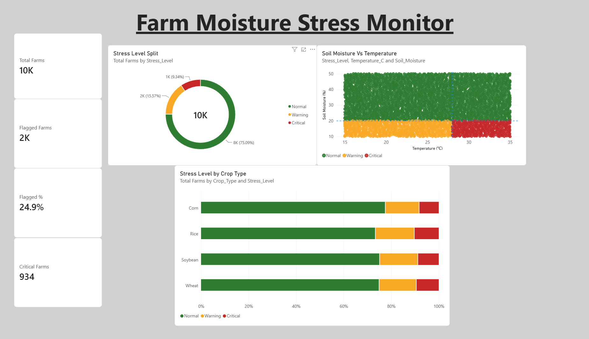
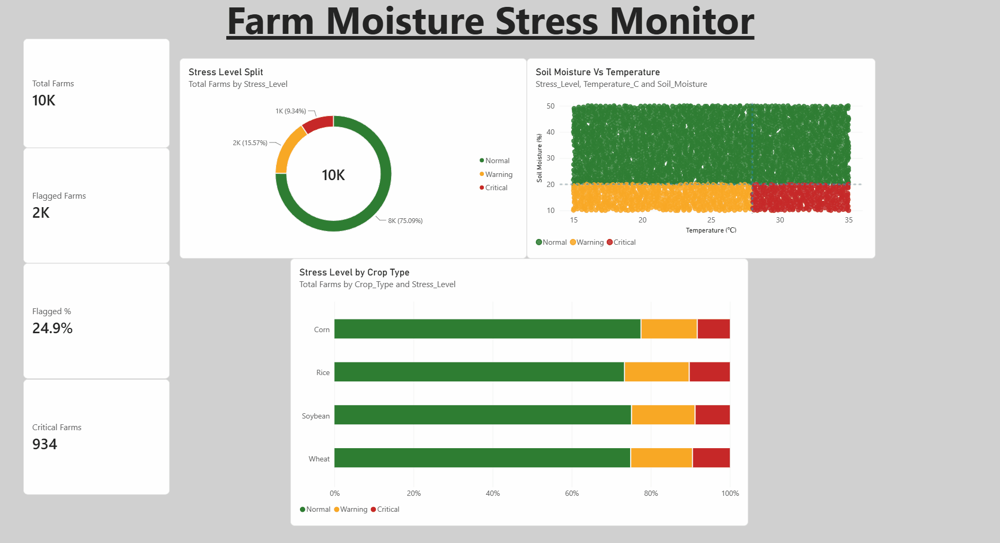

# AgriTech Data Analytics & Monitoring Dashboard

A Python + Power BI project that turns farm sensor readings into irrigation-risk alerts, to allow non-technical users to make informed decisions about farm irrigation. With climate change increasing water stresses around the globe, efficient and effective irrigation will become a priority in the future, with water shortfalls predicted to be nearly 5 billion litres per day in 2050, in England alone.

## What it does
- **Pipeline (`src/data_pipeline.py`)** – loads ~10,000 farm records with Pandas, validates and cleans them, and exports `data/processed/farm_stress_alerts.csv`.
- **Rule-based moisture stress alerts** – a farm is flagged when soil moisture is below 20%:
  - **Critical**: moisture < 20% and temperature > 28 °C
  - **Warning**: moisture < 20% and temperature ≤ 28 °C
  - **Normal**: otherwise
  - Result: 2,491 of 10,000 farms (24.9%) flagged (934 Critical, 1,557 Warning).
- **Power BI dashboard** – reads the processed CSV to show alert counts by crop type and stress level for non-technical users. *(Add screenshot: `docs/dashboard.png`)*
- **Exploratory model (`src/model.py`)** – Random Forest yield regression. R² ≈ 0 on the test set, so the available features do not predict yield; documented as a finding.

## Run it
```bash
pip install -r requirements.txt
python src/data_pipeline.py
python src/model.py
```
Place the dataset at `data/sensor_telemetry_dataset.csv`.

## Data
10,000 rows: Farm_ID, Soil_pH, Soil_Moisture, Temperature_C, Rainfall_mm, Crop_Type, Fertilizer_Usage_kg, Pesticide_Usage_kg, Crop_Yield_ton, Sustainability_Score.
Source and licence: *add link here*.

## Limitations
- The thresholds used in the project (20% soil moisture and 28°C temperature) are provided as example values and have not been scientifically calibrated for specific crops or farming conditions.
- Alerts flag risk; the project does not measure actual water saved.

## Dashboard

*Overview of the Power BI dashboard: summary cards (total farms, flagged farms, flagged %, critical farms), the split of farms by stress level, stress level by crop type, and a scatter plot of soil moisture against temperature with the 20% and 28 °C alert thresholds marked.*

*Interactive demo: selecting a stress level or crop type in the slicers filters every chart on the page, so a non-technical user can quickly see which farms and crops are at risk.*
